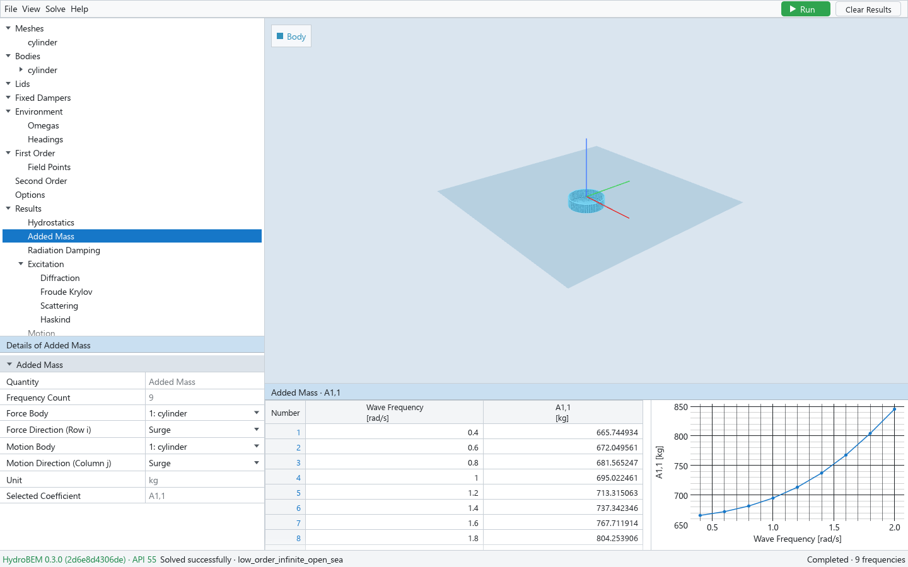

# 1. The window



*The window after a solve, with Results → Added Mass selected.*

The window has four panes and a status bar:

| Pane | Where | What it shows |
|---|---|---|
| Project tree | upper left | The model's objects, its settings and, after a solve, the results |
| Details | lower left | The properties of the node selected in the tree ("Details of …") |
| 3D viewport | upper right | The geometry, and the result colours or animation of the selected result |
| Output pane | lower right | The table of the selected node and, when it has one, its graph |
| Status bar | bottom | The engine version, the last message, the solve's progress or state |

## The menu row

| Menu | Items |
|---|---|
| File | New Project (Ctrl+N), Open Project… (Ctrl+O), Open Recent, Save (Ctrl+S), Save As… (Ctrl+Shift+S), Open Results…, Export (WAMIT (s)…, WAMIT (rad/s)…, NumPy (.npz)…), Exit |
| View | Fit, Reset Camera, Show Field Points, Show Free Surface, Show Normals, Show Spans, Output Layout (Table + Graph, Tabs) |
| Solve | Run (F5) — Stop while a solve runs —, Clear Results |
| Help | About HydroBEM (the GUI version and the engine DLL's version, commit and ABI) |

At the right end of the menu row are the green **Run** button (a red **Stop** button while a
solve runs) and **Clear Results**. While a solve runs, a small button with three lines left of Stop
opens the progress of each worker (chapter 5).

The File menu is described in chapter 7, the Solve menu in chapter 5.

## The project tree

The tree is HydroBEM's model: the model's objects first, then the environment, what to compute,
the options, and the results. Each label is the engine's name of the object in title case.

```text
Meshes                the mesh library
Bodies                each body, with what it owns below it
Lids                  damping lids
Fixed Dampers         porous sheets at rest
Environment           depth, density, gravity, walls
  Omegas | Periods    the wave frequencies
  Headings            the wave headings
First Order           what the linear solve computes
  Field Points        points in the fluid
Second Order          drifts and QTFs
Options               how the engine solves
Results               after a solve
```

Click a node to select it. Right-click Meshes, Bodies, Lids, Fixed Dampers, a body or one of
their children for the commands that add or delete objects (chapters 2 to 4). A node with
children has an arrow to expand or collapse it; a new body is collapsed.

## Details

Details show the properties of the selected node in sections that you can collapse. Each row is
a label and a value:

- **Numbers and text**: type a value and press Enter, or leave the field, to commit it. Escape
  reverts the field. There is no undo.
- **Check boxes** switch an item on or off.
- **Drop-downs** fill the whole value cell. The mouse wheel changes a drop-down only after you
  clicked it or moved into it with Tab.
- **Grey values** are read-only: computed by the GUI or the engine.

Units are in the label, in brackets (`Depth [m]`). A label cut short shows in full when you hover
over it; many rows explain themselves in a tooltip.

Numbers show up to six decimals without trailing zeros; very small or large magnitudes (below
1e-4, or 1e4 and above) show in exponent notation with seven significant digits, such as
`1.258368e+04`, which you can also type.

## The 3D viewport

The viewport shows what the selection is:

| Selected | Shown |
|---|---|
| a mesh under Meshes | that mesh alone, in its own coordinates |
| a body or one of its children | that body alone, as placed |
| a lid | that lid alone |
| Meshes | nothing (the meshes of a library overlap) |
| anything else | all bodies, lids, walls and field points |

A legend at the top left names the colours of what is drawn (Body, Free Surface, Tank, …). The
viewport draws the problem as the engine builds it, with every symmetry copy. When the engine
cannot build it, a note at the bottom of the viewport gives the reason (chapter 5).

**Camera**

| Action | Effect |
|---|---|
| Left drag | Rotate |
| Right drag (also middle drag, or Shift + left drag) | Pan |
| Mouse wheel | Zoom |
| Right-click (without dragging) → Fit | Fit the scene into the view |
| Right-click → Iso, Front, Top, Right | Standard views |
| View → Fit, View → Reset Camera | The same from the menu |

A click on a mesh shown alone picks the panel under the pointer (chapter 2); a click on a field
point picks that point (chapter 6). A click on empty space releases the pick.

**View menu options**

| Option | Default | Effect |
|---|---|---|
| Show Field Points | off | Marks the field points submitted to the solve |
| Show Free Surface | on | Draws the free surface z = 0 as a translucent plane |
| Show Normals | off | On a mesh shown alone, a red arrow along each panel's or patch's normal into the fluid |
| Show Spans | on | On a patch mesh shown alone, the curves between the spans of its discretization |

## The output pane

The output pane shows the table of the selected node (a mesh's panels, a body's points, the
frequencies, a result …) and, for results that have one, a graph. Its title says what is shown.
When the node has no table, the pane is titled "Generated Data" and stays empty.

View → Output Layout chooses **Table + Graph** (side by side, the default) or **Tabs** (Table and
Graph as two tabs). Some tables have tabs of their own above the table (a mesh's Panels and
Vertices, for example); the tab stays chosen by name when you select another node of the same
kind.

**Selecting in a table**

- Click a cell; drag to select a block.
- Click or drag on the row numbers to select rows, on a header to select columns, on the Number
  header to select everything. Shift extends the selection.
- Ctrl+C copies the selection as tab-separated text (it pastes into Excel cell by cell);
  Ctrl+Shift+C adds a header row. Values are copied as displayed.

The table's right-click menu has **Copy**, **Copy with Headers**, **Select All** and
**Export CSV…** (chapter 7).

**Editing a table**

Some tables are inputs (frequencies in table mode, matrices, points, discretization rows …):
double-click an editable cell to edit it; Enter or a click elsewhere commits, Escape cancels.
Ctrl+V pastes tab-separated text (copied from Excel, for example) from the top-left cell of the
selection; a single value fills the whole selection. Cells outside the table, in read-only
columns, or that are not numbers are left out, and the status bar counts the values pasted and
refused.

**Graphs**

Graphs plot the table's rows: point *i* of a graph is row *i* of its table. Drag to pan, scroll to
zoom, double-click to reset. A click near a point selects its table row; a row clicked in the table
picks its point, which is drawn larger in orange with its `x = …` and `y = …` values beside it. A
click on the graph away from its points releases the pick.

## The status bar

| Part | Meaning |
|---|---|
| `HydroBEM <version> · API <n>` (left, green) | The engine DLL in use; hover for its compiler and linear algebra. Red when the processor lacks AVX2. |
| Message | The last action ("Opened …", "Solved successfully · …", an error in red) |
| Right end | While solving: the phase, a bar and the elapsed time. Afterwards: "Completed · N frequencies", "Cancelled" or "Failed", or "Results out of date" in amber (chapter 5) |

## Settings remembered between sessions

The program remembers, for your Windows user:

- the window size and position;
- the recent files (File → Open Recent, the last eight);
- View → Output Layout, Show Field Points, Show Free Surface, Show Normals and Show Spans;
- the Interpolate choice of the free-surface views (chapter 6).

Everything else (the model, what is visible, the editor modes) belongs to the project and is
saved in its file. The Wave Amplitude of the result views (chapter 6) is neither remembered nor
saved.
