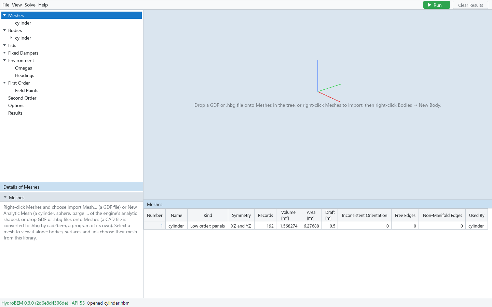
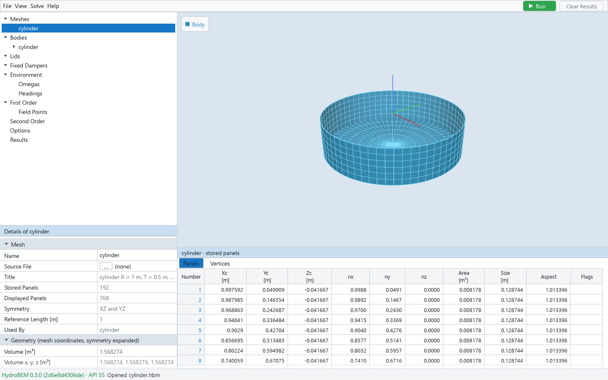
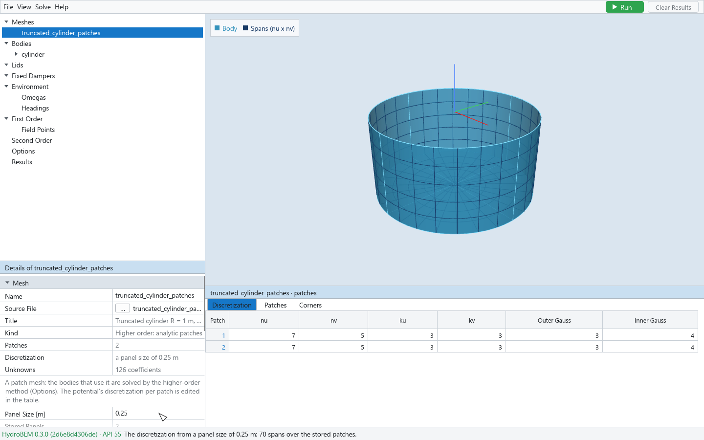

# 2. Meshes

Every surface of the model — a hull, a dipole, a lid, a control surface — takes its geometry from
the **mesh library**, the node Meshes of the tree. You import or make a mesh once and then choose
it by name wherever a mesh is needed. A new project has an empty library.

## Importing a mesh

Right-click **Meshes** → **Import Mesh…** and choose one or more files. The dialog offers:

| File | What it is |
|---|---|
| GDF (`.gdf`) | WAMIT's geometry format: the low-order panel format, or the higher-order format (B-spline, flat and analytic patches) |
| HydroBEM geometry (`.hbg`) | HydroBEM's geometry file, as cad2bem writes it |

Instead of the dialog you can drag files from Explorer onto **Meshes** (or onto one of its
meshes) in the tree: the rows are framed and labelled "Drop to import" while you drag, and every
file dropped is imported. A mesh file dropped anywhere else does nothing.

Each imported mesh appears under Meshes with the file's name; you can rename it in its Details
(Name). Wherever a mesh is chosen (Details → Mesh), the drop-down also offers **Import GDF…**,
which imports a file and assigns it in one step.

**CAD files.** The GUI does not read CAD files (STEP, IGES). They are converted by **cad2bem**, a
separate program with its own GUI, into a geometry file (`.hbg`), which you then import here. A
CAD file dropped onto the window is not read; the status bar says so.

**Higher-order GDF files.** A higher-order GDF file holds only the geometry. When an SPL file of
the same name is beside it, its discretization is read from that file. Otherwise the import first
asks for the discretization of every such file at once (dialog *Higher-Order GDF: Discretization*):

| Field | Meaning | Default |
|---|---|---|
| Panel Size [m] | Each patch gets n = floor(L / size) + 1 spans along each direction, L the longer of its two edges there (as WAMIT's PANEL_SIZE) | chosen, 1 m |
| Spans per Patch (nu x nv) | The same spans on every patch | 4 x 4 |
| Spline Order (KSPLIN) | | 3 |
| Outer Gauss Order (IQUADO) | | 3 |
| Inner Gauss Order (IQUADI) | | 4 |

**Import** reads the files; **Cancel** reads none. You can change the discretization afterwards in
the mesh's table.

**Geometry files from cad2bem.** A patch mesh read from a `.hbg` file keeps its discretization and
its patch names. When the file has no discretization, the GUI takes the recommended rows of the
cad2bem report beside it (`NAME.report.json`), else 4 x 4 spans of order 3 per patch. With a
report, the mesh's Details name it and count its ok, warn and fail patches (cad2bem Report,
Checks); when a patch failed, a red message asks you to convert the CAD again in cad2bem. A patch
mesh shown alone colours the patches whose checks warn (amber, "Check Warning") or fail (red,
"Check Failed").

## Analytic meshes

Right-click **Meshes** → **New Analytic Mesh** makes one of the engine's analytic shapes from its
dimensions. The mesh's Details then have a section **Analytic Shape**:

| Field | Meaning |
|---|---|
| Shape | Circular Cylinder, Elliptic Cylinder, Sphere, Ellipsoid, Barge, Moonpool Cylinder, Cylinder with Dipole Discs |
| Dimensions [m] | Those of the shape: Radius, Draft, Semi-Axis a (x), Semi-Axis b (y), Semi-Axis c (z), Half Length, Half Beam, Moonpool Radius |
| Interior Free Surface Patch | Adds the lid against irregular frequencies as the last patch (shapes that have one) |
| Non-Uniform Mapping | Patches mapped finer towards the waterline and the corners |
| Dipole Discs | Cylinder with Dipole Discs: the number of discs, then each disc's Outer Radius, Inner Radius and Depth |
| Patches | The number of patches (read-only) |

The shapes are quarters about x = 0 and y = 0 with their waterline on z = 0; the symmetry
expands them. Every change makes the mesh again for every user of it; the discretization per
patch is kept while the patches stay the same. When the engine refuses a change, the status bar
says why and the shape stays as it was.

A body that takes an analytic mesh with its lid patch uses that patch as its interior surface
(chapter 3).

## The mesh library table

*Meshes selected: one row per mesh of the library.*

Select **Meshes** to list the library. The viewport stays empty, because the meshes overlap.

| Column | Meaning |
|---|---|
| Number, Name | The mesh's place and name |
| Kind | Low order: panels; Higher order: flat patches, B-spline patches or analytic patches |
| Symmetry | The symmetry the mesh is stored with |
| Records | Stored panels or patches |
| Volume [m³], Area [m²], Draft [m] | The engine's geometry of the mesh alone, symmetry expanded |
| Inconsistent Orientation, Free Edges, Non-Manifold Edges | The counts of the quality findings |
| Used By | The bodies, surfaces and lids that use it |

## A mesh's Details and tables

*A low-order mesh selected: its Details, the mesh alone in the viewport, and its Panels tab.*

Select a mesh to view it alone, in its own coordinates. Its Details have:

- **Mesh**: Name, Source File, Title, Stored Panels, Displayed Panels (with the symmetry
  copies), Symmetry, Reference Length [m], File Gravity [m/s²] (when the file gives one) and Used
  By. A patch mesh adds Kind, Patches, Discretization (where its rows come from), Unknowns (the
  B-spline coefficients its discretization makes) and, for a GDF file, Panel Size [m] (below).
- **Geometry (mesh coordinates, symmetry expanded)**: the engine's volume, centre of volume,
  surface area, waterplane area and centroid, and the X, Y and Z ranges.
- **Quality**: the range of panel sizes, the largest aspect ratio, and the counts of
  inconsistent orientations, free edges and non-manifold edges.

**Reading a mesh again.** Source File has a **…** button: choose a file to read the mesh again
from it (dialog *Read Mesh Again*), or drop a GDF or `.hbg` file onto the row. Every user of the
mesh takes the new geometry.

**The tables of a low-order mesh** have two tabs:

| Tab | Columns |
|---|---|
| Panels | Number; the engine's centroid Xc, Yc, Zc [m]; unit normal nx, ny, nz into the fluid; Area [m²]; Size [m]; Aspect; Flags (orientation, free edge, non-manifold, coarse) |
| Vertices | Number, Vertex, X, Y, Z [m]: the four vertices of each stored panel (a triangle repeats one) |

**The tables of a patch mesh** have three tabs:

| Tab | Columns |
|---|---|
| Discretization | Patch; nu, nv (spans), ku, kv (spline orders), Outer Gauss, Inner Gauss — all editable; Name when the patches have names; CAD Face, Face Type, State and Checks with a cad2bem report |
| Patches | As Panels above, per patch |
| Corners | The four corners of each patch |

Edit the discretization in the table: every body that uses the mesh takes the new rows. With
**View → Show Spans** on, the viewport draws the spans of each patch (legend "Spans (nu x nv)");
the shaded surface itself is only a display tessellation, not the discretization.

**Picking panels.** Rows selected in a mesh's table (any tab) highlight their panels in the
viewport, in every symmetry copy (filled orange, outlined in red). A click on the mesh picks the
panel under the pointer, selects its rows in the table and names it in the status bar. A click on
empty space releases the pick. View → Show Normals draws each panel's normal into the fluid,
which lets you check the orientation of a mesh.

## Panel size of a patch mesh

*A higher-order mesh read from a GDF file, discretized from a panel size of 0.25 m; the spans are drawn on the patches.*

For a patch mesh read from a GDF file, Details → **Panel Size [m]** sets the discretization of
every patch from one size, as WAMIT's PANEL_SIZE: the engine reads the file again and each patch
gets n = floor(L / size) + 1 spans along each direction, spline order 3, Gauss orders 3 and 4.
Every user takes the new rows, and the status bar gives the total number of spans. The source
file must still exist and have the same patches. The size is shown until you edit a row of the
table; the project saves the rows, not the size. A geometry file (`.hbg`) keeps the discretization
it holds and has no Panel Size.

## Exporting and deleting a mesh

Right-click a mesh:

| Command | Effect |
|---|---|
| Export Mesh (.hbg)… | Writes the mesh as a HydroBEM geometry file, for any kind of mesh. Meshes are exported as `.hbg` only, not as GDF. |
| Delete Mesh | Removes the mesh from the library; disabled while the mesh is in use |

The meshes are saved inside the project file, so the original GDF or `.hbg` files are not needed
to open the project again.
