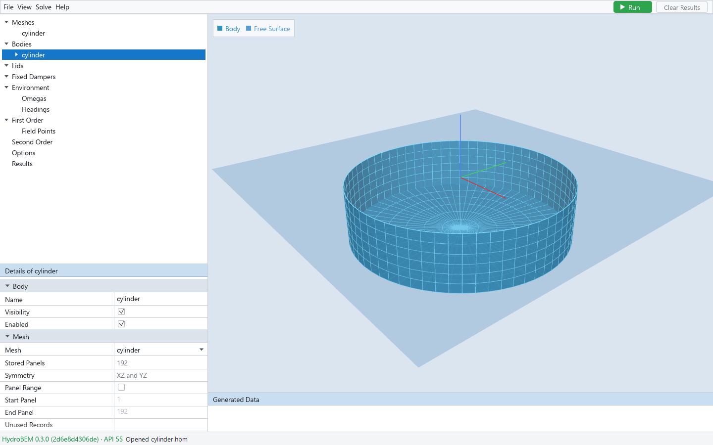

# 3. Bodies

A body is a hull (or a set of surfaces) that moves as one rigid body, with its own mesh, position,
mass and inertia. The Bodies node is empty in a new project.

## Adding and deleting bodies

Right-click **Bodies** → **New Body**. Right-click a body for its context menu:

| Command | Adds (or does) | How many |
|---|---|---|
| Add Additional Damping | A 6 x 6 damping matrix | once |
| Add Additional Stiffness | A 6 x 6 stiffness matrix | once |
| Add Dipole | A thin plate (zero thickness) | any number |
| Add Dipole Damper | A porous thin plate moving with the body | any number |
| Add Tank | An internal tank of fluid | any number |
| Add Pressure Surface | A surface of oscillating pressure (an air cushion, an OWC chamber) | any number |
| Add Free Surface Plate | A massless rigid plate in z = 0 | any number |
| Add Control Surface | The control surface of the control-surface drift | once |
| Add Body Points | The points of the body outputs | once |
| Add Generalized Mode | A displacement mode after the six rigid ones | any number |
| Add Mode Matrices | The mass, damping and stiffness of the rigid and generalized coordinates | once |
| Add Coupling | Stiffness and damping against another body | one per other body |
| Delete Body | Deletes the body | |

The children appear under the body, numbered in their order (Dipole 1, Dipole 2, …). Right-click a
child → **Delete …** to remove it. Renaming a body renames every reference to it (lids placed with
it, couplings, field points in its tanks); deleting it removes them.

*A body selected: the body alone in the viewport, its Details below the tree.*

## Body and mesh

**Body**

| Field | Meaning |
|---|---|
| Name | Unique and not empty |
| Visibility | Shows or hides the body in the viewport only |
| Enabled | Off: the body is left out of the solve (kept in the model, `enabled = false`); couplings to it go with it |

**Mesh**

| Field | Meaning |
|---|---|
| Mesh | A mesh of the library, "(none)", or Import GDF… |
| Stored Panels, Symmetry | Of the chosen mesh (read-only) |
| Panel Range | Off: every stored record of the mesh is the body's surface. On: only the records Start Panel … End Panel |
| Start Panel, End Panel | The range, when Panel Range is on |
| Unused Records | Records inside the range that no role takes, typed as `129-140, 150` |
| Wetted Panels | The wetted records, stored and displayed (read-only) |
| Reference Length [m] | Of the mesh (read-only) |

A record (panel or patch) has one role in a body. Records the body's interior surface, dipoles,
dampers, tanks or pressure surfaces take as panel ranges are left out of its wetted surface
automatically.

A body whose mesh is a patch mesh is solved by the higher-order method.

## Position, rotation centre and trim

**Position** places the body: X, Y, Z [m] of the body origin in global coordinates, and Yaw [deg]
about the global z axis. The section also has Roll and Pitch, but the engine refuses a body's own
roll and pitch before the solve: give a heeled or trimmed hull with **Trim** instead.

**Rotation Center** is the point R about which the body's motions, matrices and inertia are
taken, in body-local mesh coordinates (X, Y, Z [m]).

**Trim** (check **Trim the Hull**) gives Elevation [m], Pitch [deg] and Roll [deg]. The engine
moves the mesh and cuts it at the free surface, so a mesh with freeboard can be used. The viewport
draws what the engine keeps, and what the cut removes in translucent grey ("Cut Off by Trim").

## Modes and excitation

**Modes** has a check box for each rigid mode: 1 - Surge, 2 - Sway, 3 - Heave, 4 - Roll,
5 - Pitch, 6 - Yaw. A mode switched off is not solved.

**Excitation** → **Excitation Method** chooses how the exciting force in the body's motion
equation is computed: **Diffraction** (pressure integration) or **Haskind** (the Haskind
relation).

## Mass and inertia

**Inertia Properties**

| Field | Meaning |
|---|---|
| Mass | **Displaced** (default): the mass is the displaced volume times the water density, read-only. **Given**: you type it; switching from Displaced keeps the last computed value |
| Mass [kg] | The mass |
| Volume [m³], Center of Buoyancy [m], Waterplane Area [m²] | The engine's hydrostatics of the body alone (read-only), recomputed when the mesh or the rotation centre changes |
| Center of Gravity X, Y, Z [m] | Body-local. Needed for motions |
| Ixx, Ixy, Ixz, Iyy, Iyz, Izz [kg·m²] | The inertia about R; zero by default |

The motions (First Order → Motion) need the mass, the centre of gravity and the inertia of every
body.

## Additional matrices

**Additional Damping** and **Additional Stiffness** are full 6 x 6 matrices added to the body's
motion equation. Damping Origin (or Stiffness Origin) says the point they are given about:
Rotation Center, Center of Gravity, or Point (with Point X, Y, Z [m], body-local); the engine
moves them to R. The 36 entries are edited in Details, or, with **Edit in Table** checked, in the
output pane's table (labelled in N·s/m and N/m).

## Interior surface (irregular frequencies)

**Interior Surface** chooses how the irregular frequencies are removed:

| Choice | Meaning |
|---|---|
| None | No interior surface |
| Detect | The engine finds the wetted records lying in z = 0, an analytic mesh's lid among them (the default of a new body) |
| Projected, Waterline, Graded | Generated by the engine from the waterline |
| Panel Range | Records of the body's mesh: Start Panel, End Panel and Further Ranges |
| Mesh | A mesh of the library, in body coordinates |

Preview gives the number of panels of the surface as the engine builds it; the viewport draws it.
The solve passes the method, and the engine builds the surface again.

A body with a patch mesh offers None, Detect, Panel Range and Mesh (and the Mesh must be a patch
mesh too), and Waterline when the body is trimmed; another choice kept from before is named in red.
If the body's analytic mesh has an interior free-surface patch that is still part of the wetted
surface, a red message says it would be solved as hull at z = 0: take it with Detect or Panel
Range, or switch Interior Free Surface Patch off in the mesh's Details.

## Surfaces of a body

Most surfaces are **records of the body's mesh**: Start Panel, End Panel, and **Further Ranges**
for more ranges (`129-140, 150`). Each has an **Enabled** check: switched off, the surface is
solved as if absent, and its records still stay out of the wetted surface.

**Dipole** — a thin plate (heave plate, skirt). Source: **Panel Range of the Body Mesh** or
**Mesh** (a mesh of the library).

**Dipole Damper** — a porous thin plate moving with the body: a record range of the body mesh and
its Damping Factor [m/s].

**Tank** — an internal tank. Its walls are a record range of the body mesh with normals into the
tank fluid.

| Field | Meaning |
|---|---|
| Density Ratio | Tank fluid density over the water density |
| Surface Level | Walls Top (the top of the walls) or Given (Surface Level Z [m], body-local) |
| Sheets Inside | Number of sheets in the tank; each section *Tank k · Sheet j* has Kind (Dipole or Dipole Damper), its record range and, for a damper, Damping Factor [m/s] |
| Free Surface Plates | Number of plates on the tank's surface (a deck, a cover); each section *Tank k · Free Surface Plate j* takes records of the body mesh or a library mesh at the tank's surface level |

**Pressure Surface** — a surface on which the pressure oscillates (an air cushion, an OWC
chamber). A pressure surface must point down, into the water (check with View → Show Normals).

| Field | Meaning |
|---|---|
| Source | Panel Range of the Body Mesh, or Mesh |
| Chamber Coupling | The restoring coupling of a constant-volume chamber |
| Response Convention | Variational or Numeric Compatibility |
| Pressure Modes | Number of pressure modes; each section *Pressure Surface k · Mode j* has Shape (Uniform, Sign of X, Sign of Y), Additional Stiffness [N/m] and Additional Damping [N·s/m] |

**Free Surface Plate** — a massless rigid plate in z = 0 with water below it only; it moves with
the body's rigid modes. Source:

- **Panel Range of the Body Mesh** or **Mesh**: records in z = 0 (a library mesh in body axes);
- **Generated in a Waterline**: the engine makes the plate — the water of z = 0 inside the
  waterline loop of a trimmed hull that holds the point Inside X, Inside Y [m] (in that hull's
  axes after its trim). **Waterline Of** chooses the hull: This Body (which then needs a trim) or
  another body.

A body of plates alone (no mesh of its own) is solved with the mesh of its first plate. The engine
refuses free-surface plates in some combinations with other inputs, and names the reason.

**Control Surface** — the closed surface around the body used by the control-surface drift and
QTF (chapter 4).

| Control Surface | Fields |
|---|---|
| Cylinder | Radius, Depth, Inner Radius [m] |
| Ellipsoid | Semi-Axis a, b, c; Inner Semi-Axis a, b [m] |
| Automatic | Outer: Circle (Radius) or Polygon (Polygon Points); Partitions and their Line k Points; Depth [m]. The (x, y) points are edited in the table (Line 0 is the outer boundary), in body coordinates |
| Mesh | A mesh of the library |

All but Mesh have a Panel Size [m]. **Waterline Term** puts the waterline term on the Control
Surface or on the Body.

## Body points

**Body Points** replace the panels as the points where the body outputs (First Order → Body
Pressure, Body Velocity) are given. Set **Count** and edit X, Y, Z [m] (body-local) in the table.
Body points apply to every body or to none: the engine's rule.

## Generalized modes and mode matrices

**Generalized Mode** — a displacement mode after the six rigid ones.

| Field | Meaning |
|---|---|
| Name | The mode's name |
| Parity | The rigid mode whose symmetry it has (Surge … Yaw) |
| Pieces | Number of pieces; each section *Piece j* has Panel Range (off: every record of the body mesh), Start Panel, End Panel, Further Ranges, and the numbers of u Terms, v Terms and w Terms |
| Scale (section Display) | The viewport shows the wetted hull displaced by this many units of the coordinate; 0 is off. Display only |

Each term is c x^px y^py z^pz; edit c, px, py, pz in the table (Piece, Component u/v/w).

**Mode Matrices** are the (6 + G) x (6 + G) mass, damping and stiffness of the rigid and the G
generalized coordinates. **Table Shows** chooses which one the table edits. The rigid block of the
mass is zero: the body's own mass and inertia fill it.

## Couplings

**Coupling** holds two 6 x 6 matrices of this body's forces against the motions of **Other Body**:
Stiffness [N/m] and Damping [N·s/m], each about the origin of each body's additional matrices.
**Matrix** chooses which one Details and the table show; **Edit in Table** moves the editing to
the table. The other direction is a coupling of the other body. A coupling has its own
**Enabled** check.

## When the engine cannot build a body

The viewport draws the body as the engine builds it. When the engine refuses the inputs (two
surfaces taking the same record, for example), the GUI draws the surfaces from the
inputs and a red note at the bottom of the viewport gives the engine's reason. See chapter 5.
