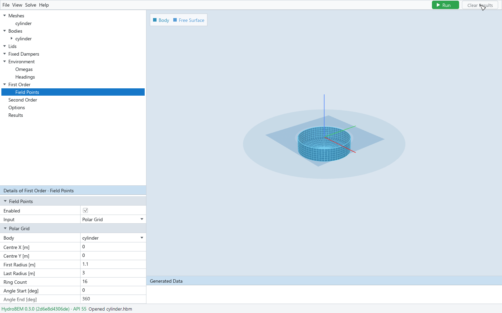

# 4. Environment and outputs

This chapter covers the model's objects besides bodies (lids and fixed dampers), the water, the
wave frequencies and headings, what the solve computes, the field points and the solver options.

## Lids

Damping lids damp the free surface (in a moonpool or a gap, for example). Right-click **Lids** →
**New Lid**; right-click a lid → **Delete Lid**.

| Field | Meaning |
|---|---|
| Name, Visibility, Enabled | As for a body (chapter 3) |
| Damping Factor | The lid's damping factor |
| Placed With | **(global coordinates)**: the lid is a mesh of its own, chosen in the section Mesh. **A body**: the lid is a record range of that body's mesh (Start Panel, End Panel, Further Ranges), placed by the body's position and yaw; those records leave the body's wetted surface |

A lid placed with a body that is not Enabled is refused: switch the lid off too.

## Fixed dampers

Fixed dampers are porous sheets at rest, in global coordinates. Right-click **Fixed Dampers** →
**New Fixed Damper**. Details: **Enabled**, **Mesh** (a mesh of the library) and **Damping Factor
[m/s]**.

## Environment

| Field | Meaning | Default |
|---|---|---|
| Depth Type | Infinite or Finite | |
| Depth [m] | The water depth (Finite only) | |
| Density [kg/m³] | Water density | 1025 |
| Gravity [m/s²] | | 9.80665 |
| Domain | Open Sea, Wall at X = 0, Wall at Y = 0, Orthogonal Walls, Channel | |
| Channel Width [m], Channel Reflect | The channel (Channel only) | |

The viewport draws the walls and, at finite depth, the sea bed, on the fluid side only (x > 0,
y > 0, both, or between the channel walls). Changing density or gravity updates the bodies'
displaced mass.

## Frequencies and headings

Select **Omegas** (or **Periods**) under Environment for the wave frequencies:

| Field | Meaning | Default |
|---|---|---|
| Frequency Input | Omegas (rad/s) or Periods (s); the tree node is named after it | Omegas |
| Edit in Table | Off: Start, End and Count generate evenly spaced values. On: you edit the values in the table | |
| Start, End [rad/s] or [s] | The first and last value (generator only) | 0.1, 2 rad/s |
| Count | The number of values; in table mode it adds or removes rows | 20 |

The table lists, per row, the wave frequency or period you give, the other form, the wave number
[1/m] (from the engine, at the depth set) and the wave length [m]. Switching Edit in Table on
keeps the rows.

**Added Mass Limits** (section of the same node): **Zero Frequency (ω = 0)** and **Infinite
Frequency (ω = ∞)** have the engine solve the added mass at these limits besides the wave
frequencies. They appear with Added Mass in the results (chapter 6).

Select **Headings** for the wave headings: Start, End [deg] and Count (defaults 0, 360 and 1).
The table lists the headings.

## First Order

What the linear solve computes:

| Field | Meaning |
|---|---|
| Radiation | Added mass and damping: the radiation problems of the modes |
| Diffraction | Wave loads: the diffraction problem of every heading |
| Diffraction Formulation | Scattered, Total, or Auto (the engine's choice) |
| Motion | The motions (RAOs). Needs radiation, diffraction, and the mass, centre of gravity and inertia of every body |
| Field Pressure | At the field points: the free-surface elevation at z = 0, the pressure p/ρg below. Greyed out without field points; on by default |
| Field Velocity | The fluid velocity at the field points. Greyed out without field points |
| Body Pressure | p/ρg on the bodies: at the panels, or at the body points |
| Body Velocity | The fluid velocity on the bodies, at the same points |

## Field points

*First Order → Field Points with a Polar Grid about the body: the rings show as a translucent plane before a solve.*

Select **Field Points** under First Order. Check **Enabled** and choose the **Input**:

**Grid** — a rectangular grid: X Start, X End, X Count, Y Start, Y End, Y Count.

**Polar Grid** — rings about a centre: Body, Centre X, Centre Y, First Radius, Last Radius, Ring
Count, Angle Start, Angle End, Angle Count.

**Body-Fitted Grid** — rings at a distance outside the chosen Body's section at Z, by angle about
the section's centre: Body, First Ring Offset, Last Ring Offset, Ring Count, the angles, and:

- **Convex Outline**: rings about the convex hull of the section, one outline about several
  columns. It switches on by itself when you first choose a Body-Fitted Grid for a section in
  parts; when it is off for such a section, a red message says so.
- **Inside Rings**: rings between the centre and the outline, for the water between columns;
  points that fall inside a body are left out.

For both ring layouts, angles from Angle Start to Angle End over a whole turn close without
repeating the first angle, and **Fit to Body** → **Fit** sizes the rings to the body's section at
Z (the counts are kept).

**Point List** — each point by itself, in global coordinates: set **Number of Points** and edit
X, Y, Z [m] and Tank in the table (Tank 0 is the exterior, k the k-th tank of the bodies in
order). Switching to a list starts from the grid's points.

For the grids:

| Field | Meaning |
|---|---|
| Z [m] | The level of the grid |
| Further Depths | More levels of the same grid (Z 2, Z 3, …); the result views then choose the depth |
| In Tank | Exterior, or a tank of a body: the points lie in that tank |
| Generated Points, Excluded Inside Bodies, Excluded by the Engine, Submitted Points | Counts (read-only) |
| Near a Body (warning) | Points closer to a panel than its size: kept, but less accurate |

Points outside the fluid (inside a body, beyond a wall, outside a channel, above z = 0, at or
below the sea bed) are not submitted to the solve. Field Pressure and Field Velocity (First Order)
need at least one field point.

The heatmap of a result is drawn between the points of the grid (chapter 6). More points give
more solver samples; the display interpolation does not.

## Second Order

**Drift** (the mean drift force):

| Field | Meaning |
|---|---|
| Pressure Integration | By pressure integration over each body (body axes) |
| Control Surface | By the momentum flux through each body's control surface (add a Control Surface to the body) |
| Momentum Conservation | Surge, sway and yaw of all bodies in global axes, from the Kochin functions |
| Momentum Conservation Angles: Auto, Momentum Conservation Angles | The number of angles: the engine's choice, or the number given |
| Bidirectional | Every pair of two headings, not only each heading with itself |

**QTF** (the quadratic transfer functions at the difference and sum frequencies of every pair of
frequencies; the total is a quadratic part plus a potential part):

| Field | Meaning |
|---|---|
| Quadratic Pressure Integration | The quadratic part by pressure integration over each body |
| Quadratic Control Surface | The quadratic part over each body's control surface |
| Potential Direct, Potential Indirect | The force of the second-order potential, by the direct or the indirect method (low order) |
| Newman, Newman Average | Newman's approximation of the difference-frequency QTF from the mean drifts switched on, with the Geometric or Arithmetic average |
| Difference, Sum | Which frequencies: ω_a − ω_b, ω_a + ω_b. Turn on at least one |
| Bidirectional | Every pair of two headings |

With a potential QTF, the section **Free Surface (Potential QTF)** sets the free-surface
integration: Free Surface Method (Panels, Cells or Mesh); Free Surface Panel Size and Free Surface
Inner Radius [m] (Panels, Cells), or a library mesh in z = 0 and Free Surface Quadrature Points
(Mesh); Quadrature Annuli, Quadrature Radius Step, Quadrature Radial Nodes, Quadrature Azimuthal
Nodes, Outer Circle Segments and Expansion Order. A row with ": Auto" leaves that value to the
engine; uncheck it to type your own. The tooltips give the engine's automatic rules.

For the meaning of the methods and when to use which, see HydroBEM's documentation.

## Options

| Field | Meaning |
|---|---|
| Core | The engine in use (read-only) |
| Logarithmic Integration, Log Tolerance | The engine's logarithmic integration and its tolerance |
| Frequency Threads | The number of frequencies solved at a time; each needs its own memory |
| Inner Threads | The threads inside each frequency |
| Estimated Memory | The engine's estimate for the solve (shared, per frequency, outputs) and the free memory |

The memory estimate is the engine's and leaves out the GUI's own copies of the results. When it
exceeds the free memory, Run asks before solving (chapter 5).
