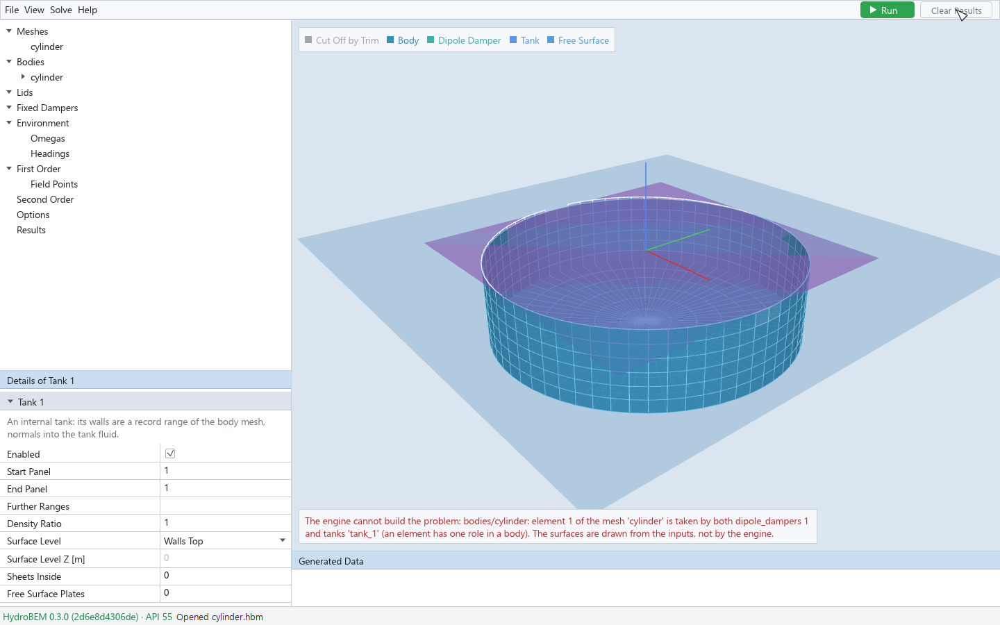
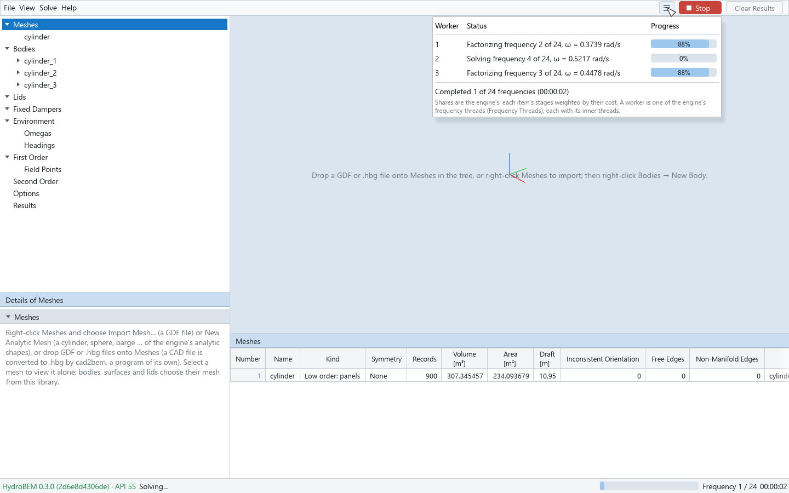
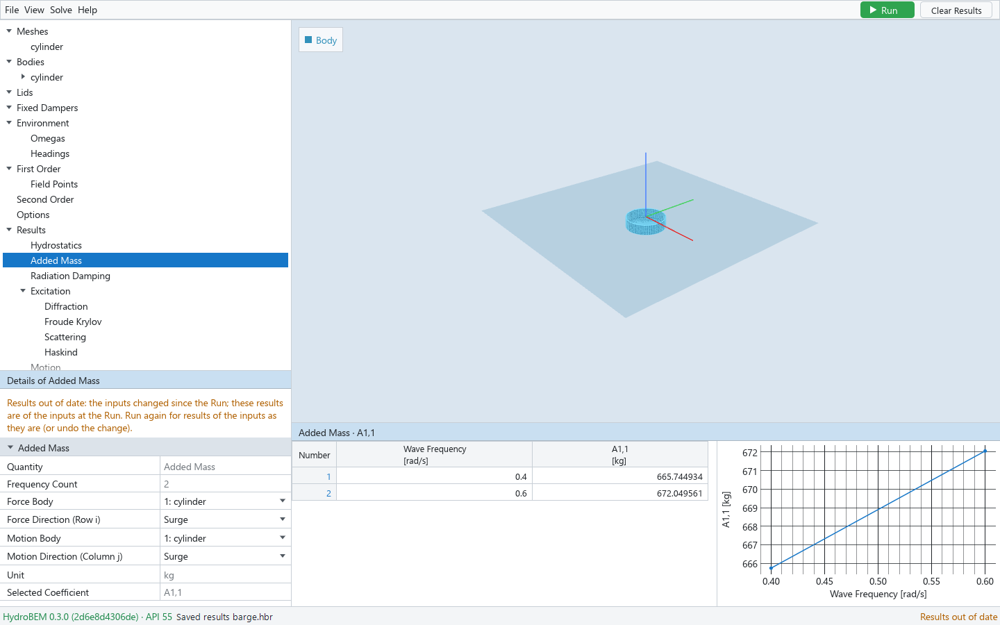

# 5. Solving

## Before you run: the engine's checks

The GUI asks the engine about the model while you edit it, so many problems show before a solve:

- The viewport draws the problem as the engine builds it. When the engine cannot build it, the
  GUI draws the surfaces from your inputs instead and a red note at the bottom of the viewport
  starts with "The engine cannot build the problem:" and gives the engine's reason.
- Details show the engine's view of a mesh (geometry, quality), of a body (volume, wetted panels,
  the interior surface's preview), of the field points (how many it excludes) and the memory
  estimate (Options).

*A tank and a dipole damper take the same record of the body mesh: the viewport note gives the engine's reason.*

## Run

Press the green **Run** button at the right of the menu row, **F5**, or **Solve → Run**. A value
you are still typing is committed first. The solve takes the inputs as they are at that moment;
you can go on editing while it runs.

If the engine refuses the model, a message box **Cannot solve** gives the reason and, after "At:",
where it applies; the body concerned is selected in the tree.

If the engine's memory estimate is larger than the free memory, a dialog **Memory** gives both
numbers: **Solve** runs anyway (the engine's own memory check is turned off for that solve, so
it does not refuse it for the same reason), **Cancel** does not.

## Progress

*A solve with three frequency workers: the progress table open below the Stop button, the phase and elapsed time in the status bar.*

While a solve runs:

- the Run button turns into a red **Stop** button;
- the right end of the status bar shows the phase — Preparing, `Frequency done / total` (the
  added-mass limits counted), Second order with the running step, or Writing the results — with a
  progress bar and the elapsed time;
- a button with three lines left of Stop (tooltip "The progress of each worker") opens a table
  with one row per frequency worker of the engine (Options → Frequency Threads):

| Column | Shows |
|---|---|
| Worker | The worker's number |
| Status | What the worker is on, as the engine reports it: a limit or a frequency with its stage and ω ("Factorizing frequency 12 of 40, ω = 0.6000 rad/s"), a step of the second order, work all workers share, Idle, or Done |
| Progress | The share of the item: blue with its percentage while it runs, green at 100 % when done |

Below the rows: "Completed n of N frequencies" and the elapsed time. Once the second order begins,
its steps follow in the order they began. The table closes when the solve ends.

## Stop

Press **Stop** (or F5, or Solve → Stop) to cancel the solve. The status bar says "Cancelling…",
then "The solve was cancelled."; the right end says "Cancelled". No results are kept from a
cancelled solve.

If you close the window while a solve runs, a dialog **A solve is running** asks first: **Stop
and Exit** stops the solve and closes the window once it has stopped (after the unsaved-changes
prompt, chapter 7); **Cancel** keeps the window open.

## After the solve

**Success.** The status bar says "Solved successfully · <route>" (the engine's solution route)
or "Solved with N engine warning(s) · <route>", the right end "Completed · N frequencies", and the
**Results** node is selected (chapter 6). The engine's warnings are listed in the section **Engine
Warnings** of the Results node's Details, each with where it applies.

**Failure.** A message box **The solve failed** gives the engine's message and, after "At:", where
the engine located the error; the body concerned is selected. The right end of the status bar
says "Failed".

## Results out of date

*An input changed after the Run: the status bar and every result's Details say so.*

The results stay shown while you edit the inputs. Once the inputs differ from those of the
results (solved, or read from a results file), the results are **out of date**: the right end of
the status bar says "Results out of date" in amber, and the Details of every result node begin with
the same message. Undoing the change makes them current again; Run, Clear Results or opening a
file ends it. While the results are out of date, File → Save writes the model, not the results
(chapter 7).

## Clear Results

**Clear Results** (beside Run, or Solve → Clear Results) forgets the last solve. The Results node
then says "No results yet: press Run (top right, or F5) to solve." Only the last solve is kept in
memory; save it as a results file to keep it (chapter 7).
