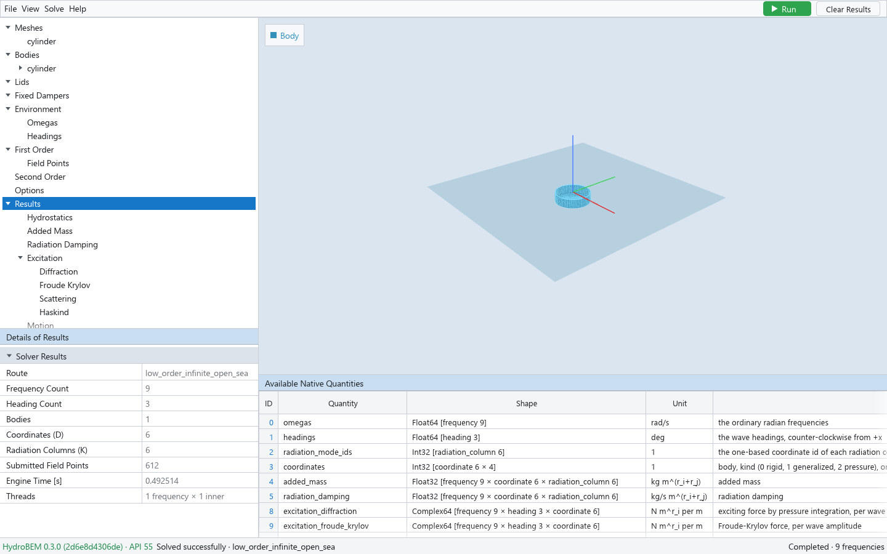
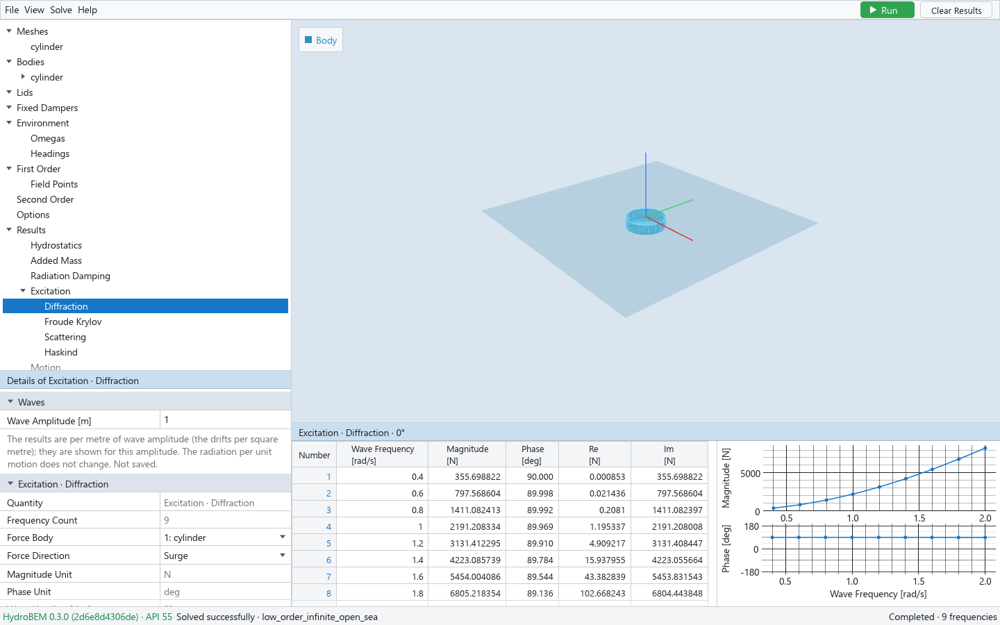
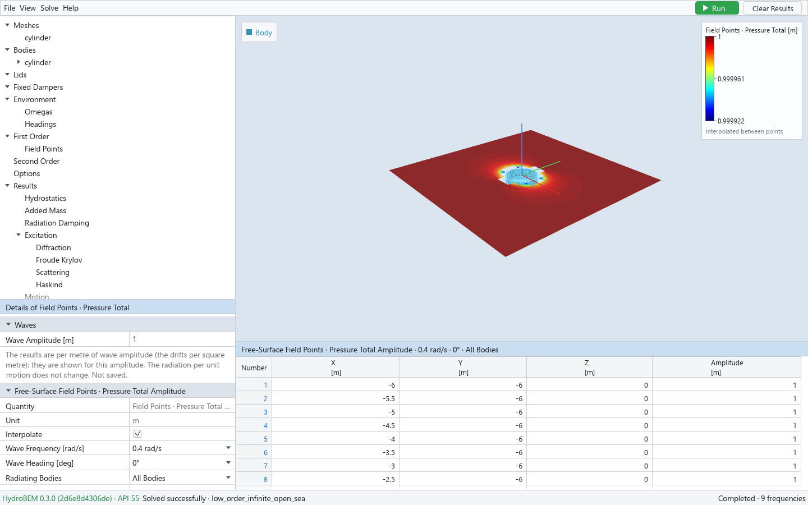
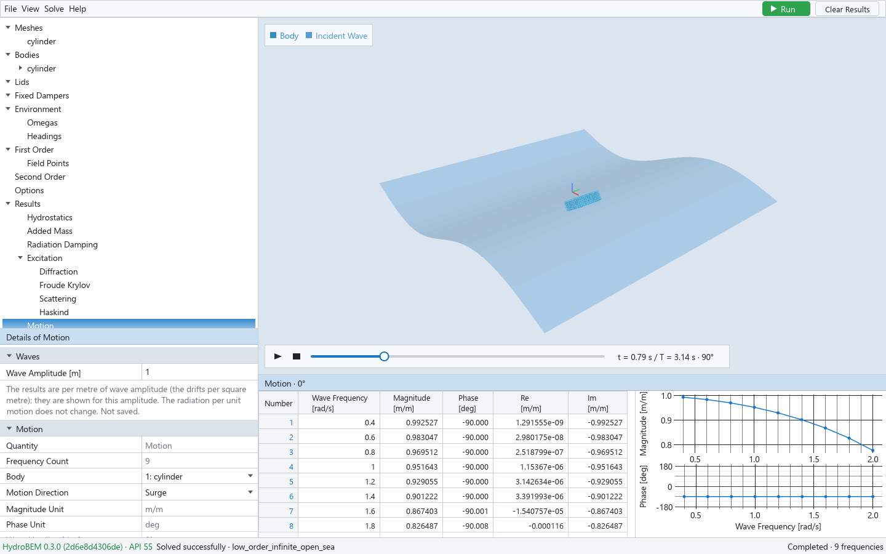
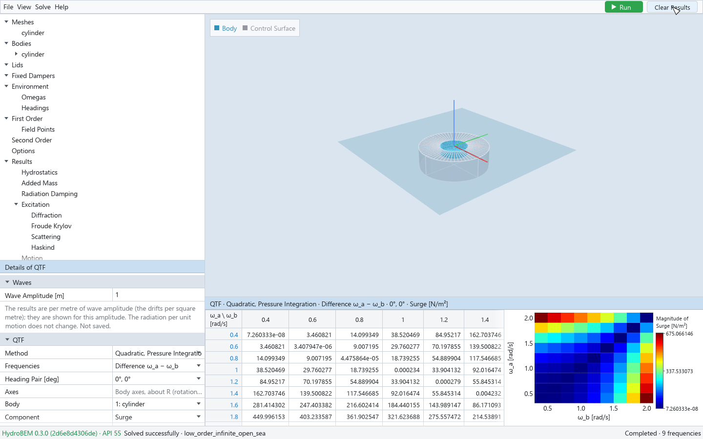

# 6. Results

After a solve, the **Results** node of the tree holds the engine's results. Select a node to see
its choices in Details, its table (and graph) in the output pane, and its colours or animation in
the viewport. The units, conventions and normalization of every quantity are HydroBEM's; see
HydroBEM's documentation.

## The Results tree

A node is shown only when the solve computed its quantity.

| Node | Children |
|---|---|
| Results | The solve summary |
| Hydrostatics | |
| Added Mass, Radiation Damping | |
| Excitation | Diffraction, Froude Krylov, Scattering, Haskind |
| Motion | |
| Body Points | Pressure, Velocity |
| Field Points | Pressure Radiation, Pressure Incident, Pressure Scattering, Pressure Diffraction, Pressure Total, Velocity |
| Lids | Elevation |
| Pressure Surfaces | Elevation, Pressure Mode Damping |
| Kochin, Drift, QTF | |

Details and the output pane title a node by its path ("Lids · Elevation"). A body is chosen in
Details, not in the tree.

## The summary

*The Results node: the solve summary and the table of the quantities the solve computed.*

The **Results** node's Details (section Solver Results) give the Route (the engine's solution
route), Frequency Count, Heading Count, Bodies, Coordinates (D), Radiation Columns (K), Submitted
Field Points, Engine Time [s] and Threads; then the **Engine Warnings**, if any. The table
**Available Native Quantities** lists every quantity of the results with its engine name, shape
(element type and axes), unit and description.

## Wave amplitude

The engine's results are per metre of incident wave amplitude (the mean drifts and QTFs per square
metre); the radiation quantities are per unit motion. The views of what the waves drive (wave
loads, motions, free surface, drifts, QTFs, Kochin functions, point values) have a section
**Waves** with **Wave Amplitude [m]** (1 at first): their tables, graphs, heatmaps, animation and
CSV export show the values for that amplitude, the units become those of the waves (`m/m` becomes
`m`, `N/m²` becomes `N`), and the title adds "A = … m". Added mass, damping, hydrostatics and the
radiation per unit motion do not change. The amplitude applies to every view, is not saved, and
results files and exports to WAMIT format or NumPy keep the engine's per-unit values.

## Tables and graphs

Most views show a table and a graph of one selection over the wave frequency. Point *i* of the
graph is row *i* of the table; picking, zooming and copying work as in chapter 1. Phases are in
degrees, from −180 to 180.

### Added Mass and Radiation Damping

The figure of chapter 1 shows Added Mass: the table and graph of A1,1 (surge on surge) over the
wave frequency.

| Field | Meaning |
|---|---|
| Force Body, Force Direction (Row i) | The row of the coefficient |
| Motion Body, Motion Direction (Column j) | The column |
| Unit, Selected Coefficient | E.g. `kg` and `A1,1` |
| At ω = 0, At ω = ∞ | The added-mass limits, when solved |

The directions are a body's coordinates: Surge … Yaw, then Generalized k and Pressure k when the
body has them. If the selected motion mode was not solved, Details say so.

When the added-mass limits were solved (Omegas → Added Mass Limits), the Added Mass table ends with
the rows A(0) and A(∞), the graph shows them as two points named in a legend (A(∞) at the right
edge), and the tabs **ω = 0 Matrix** and **ω = ∞ Matrix** show the whole blocks of the chosen force
and motion bodies.

### Excitation and Motion

*Excitation · Diffraction: magnitude and phase of the surge force over the wave frequency, heading 0°.*

| Field | Meaning |
|---|---|
| Force Body, Force Direction (Motion: Body, Motion Direction) | The force, or the motion, shown |
| Magnitude Unit, Phase Unit | Units of the columns |
| Wave Heading [deg] | One of the solved headings |
| Graph Components | Magnitude / Phase (default) or Real / Imaginary |

The table has Magnitude, Phase, Re and Im for every frequency. Under Excitation, **Diffraction** is
the exciting force by pressure integration, **Froude Krylov** and **Scattering** its parts, and
**Haskind** the whole exciting force by the Haskind relation (only for the radiated coordinates):
compare it with Diffraction.

### Hydrostatics

Choose the **Body**. Details give the engine's hydrostatics of the solve in body axes: Displaced
Volume, Centre of Buoyancy, Waterplane Area and Centroid, the Mass and Centre of Gravity, and GM
Transverse and GM Longitudinal when the body has a mass and centre of gravity. The table is the
6 × 6 hydrostatic stiffness about R, with the weight terms when the body has a mass and centre of
gravity.

### Pressure Mode Damping

Under Pressure Surfaces: the engine's damping of the pressure coordinates, as a table.

## The free surface and the field points

*Field Points · Pressure Total: the amplitude of the elevation around the body, with its colour bar.*

The Field Points views show the free-surface elevation at the field points at z = 0 (and the
pressure p/ρg below z = 0, labelled so):

| View | Source |
|---|---|
| Pressure Radiation | The radiation of one mode, per unit motion: choose **Radiating Body** and **Radiation Mode** |
| Pressure Incident, Pressure Scattering | The incident and scattered waves |
| Pressure Diffraction | Incident + scattering: the fixed-body elevation |
| Pressure Total | Incident + scattering + the radiation of the moving bodies times their motions. Choose **Radiating Bodies** (All Bodies or one body) and **Radiation Modes** |

The Total is the GUI's sum of the engine's quantities, as HydroBEM defines it; without solved
motions it shows the fixed-body elevation and says so. Choose the **Wave Frequency [rad/s]**, the
**Wave Heading [deg]** and, with Further Depths, the **Depth**. Details also count the Submitted
Points and Excluded Points and give the Amplitude Range [m].

The table lists the points with their amplitude. The viewport shows the amplitude (the magnitude
of the complex amplitude, not a snapshot in time) as a heatmap with a colour bar, drawn between
the points of the grid only: never beyond the outermost points, nor in a cell with a point the
engine left out. A click on a field point (View → Show Field Points marks them) selects its table
row, and a selected row marks its point.

**Interpolate** (on by default, remembered) colours each cell bilinearly between its four points;
off, a cell is one colour, the mean of its corners. **Interpolation is visualization only**: it
adds no solver samples. For a finer result, give more field points (chapter 4).

**Velocity** under Field Points, and the views **Body Points · Pressure**, **Body Points ·
Velocity**, **Lids · Elevation** and **Pressure Surfaces · Elevation**, are tables at the output
points for one frequency and one heading (Diffraction) or one radiating mode (Radiation): choose
the **Quantity** first. The viewport colours them: body values on their panels (or patches), the
velocities by the component chosen in **Colour By**. The lid and pressure-surface points are
triangulated in plan and coloured between them; the colour bar says "interpolated between
points" — again a display only.

## Animation

*Motion with Animate on: the body moves in the incident wave; the player at the bottom of the viewport.*

Motion, the Field Points pressure views on a grid, and Body Points · Pressure and Velocity have a
section **Animation**. Check **Animate** to show Re{X e^{iωt}} of the solved amplitudes in time:

| Field | Meaning |
|---|---|
| Wave Frequency [rad/s] | The frequency animated (Motion) |
| Move Bodies | Radiation, and Total with motions: off keeps the bodies still (the surface still includes their radiation) |
| Speed | 0.25 × real time … 4 × real time |
| Display Scale (×) | Multiplies the displacements; 1 (the default) is the real size at the Wave Amplitude |

The player at the bottom of the viewport repeats one period: play/pause and stop (back to the
start) at its left, the period as a bar to click or drag to a phase, and the time t / T and the
phase at its right. Motion moves the bodies rigidly about R with the incident wave on the free
surface; a free-surface view raises the field-point surface by the elevation and moves the bodies
its radiation includes. The animation is a display of the linear result, not a larger-amplitude
solution; generalized and pressure modes, lid and pressure-surface elevations and field velocities
are not animated.

## Kochin functions

**Kochin** (computed with the momentum-conservation drift): choose the **Potential** — Diffraction
(Scattered), Radiation, or their angular derivatives — the **Wave Frequency [rad/s]** and the
heading or the radiating mode. The table and the magnitude/phase graph are over the engine's
angles.

## Drift

| Field | Meaning |
|---|---|
| Method | Pressure Integration, Control Surface, Momentum Conservation, Momentum, Heading Pairs, Pressure Integration, Moving Origin, Control Surface, Moving Origin — those the solve computed |
| Axes | Body axes about R, body axes about the moving R, or global (all bodies) for momentum conservation |
| Body | The body (not for momentum conservation) |
| Component | Surge … Yaw (momentum conservation: Surge, Sway, Yaw) |
| Wave Heading [deg] | The heading, with itself |

The table has every component over frequency; the graph shows the chosen one. **Momentum, Heading
Pairs** (with Bidirectional drift) is instead a table of the first heading against the second at
one **Wave Frequency [rad/s]** and **Component**, showing the Magnitude, Real or Imaginary part
(**Show**).

## QTF

*QTF · Quadratic, Pressure Integration, difference frequencies, surge: the table ω_a × ω_b and its heatmap.*

| Field | Meaning |
|---|---|
| Method | Quadratic, Pressure Integration; Quadratic, Control Surface; Potential, Direct; Potential, Indirect; Total, … + … (each quadratic part with each potential part solved); Newman, … (of each drift) |
| Frequencies | Difference ω_a − ω_b or Sum ω_a + ω_b |
| Heading Pair [deg] | The pair of headings (Newman: Wave Heading [deg]) |
| Body, Component | The body and its coordinate, in body axes about R (Newman of momentum conservation: Surge, Sway, Yaw in global axes) |
| Show | Magnitude, Real, Imaginary or Phase |
| Graph | Heatmap, or Row ω_a with **Graph Row ω_a**: magnitude and phase over ω_b for one row |

The table is ω_a (rows) against ω_b (columns). In the heatmap, hover over a cell for its value and
click it to select its row in the table. The Total is the GUI's sum of the engine's quadratic and
potential parts, element by element; the engine gives the parts only. The heatmap colours the range
of the values shown.
