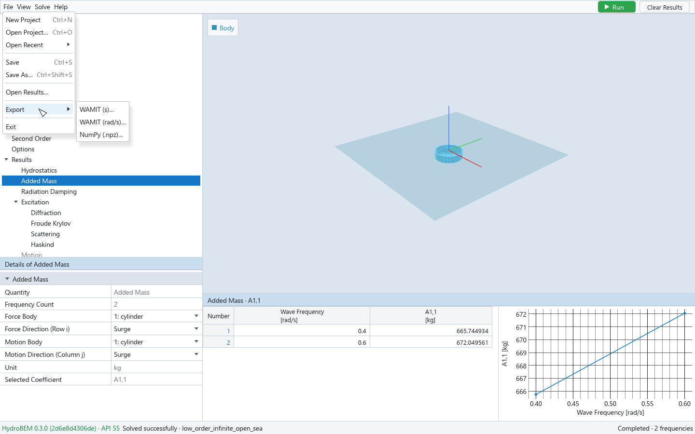

# 7. Files and export

The GUI reads and writes HydroBEM's own files, through the engine:

| File | Contents |
|---|---|
| Model file (`.hbm`) | The whole model — every object, the meshes inside — and the GUI's state (visibility, editor modes, the field-point grid …) |
| Results file (`.hbr`) | The model as it was solved, with the run's information, the engine's warnings and every computed quantity |

Python reads and writes the same files (`hb.Model.load`, `m.save`, `hb.Model.load_results`; see
[the Python API](../python/README.md)), so a model made by a script opens in the GUI and the other
way round. The meshes are stored inside the files: the original GDF or `.hbg` files are not needed
again.

## The File menu

| Item | Effect |
|---|---|
| New Project (Ctrl+N) | Starts an empty project |
| Open Project… (Ctrl+O) | Opens a model file; opening replaces the model and clears the results |
| Open Recent | The last eight files opened or saved (files that no longer exist are greyed); Clear Recent Projects empties the list |
| Save (Ctrl+S) | Saves the project (below) |
| Save As… (Ctrl+Shift+S) | Saves under a new name, as model or results |
| Open Results… | Opens a results file: its model and its results, as after a solve |
| Export | WAMIT (s)…, WAMIT (rad/s)…, NumPy (.npz)… — enabled once there are results |
| Exit | Closes the window |

New Project, Open Project…, Open Recent and Open Results… are disabled while a solve runs.

You can also start the program with a file: `HydroBEM.exe barge.hbm` or `hydrobem-gui barge.hbr`.

## Saving

**Save** writes:

- the **results file** (`.hbr`) once Run has solved the project as it is: beside the project's
  file under its name (`barge.hbm` → `barge.hbr`), or where the dialog says when the project has
  no file yet. The results file then becomes the project's file;
- the **model file** (`.hbm`) before a Run, or when the inputs changed after the Run (the results
  are out of date; a results file already written stays as it is).

**Save As** offers both file types — HydroBEM results first, then HydroBEM model — while there are
results of the project as it is, otherwise the model only, and writes the type you choose.

A results file opened with Open Results… is the project's file: Save writes it again, with the
results while they are current.

Files are written to a temporary name beside the target and then renamed, so a failed save leaves
the old file intact.

## Unsaved changes

A project is unsaved when what it would save differs from what was last opened, saved or created;
every input and every piece of GUI state counts. New Project, Open Project…, Open Recent, Open
Results… and closing the window ask first:

> **Unsaved changes** — The project has unsaved changes. Save them first?

**Save** saves and then continues, **Discard** continues without saving, **Cancel** stops. The
window title does not mark unsaved changes; you find out when the prompt is due.

## Dropping files onto the window

| Dropped | Effect |
|---|---|
| A model file (`.hbm`) anywhere | Opens as File → Open Project… |
| A results file (`.hbr`) anywhere | Opens as File → Open Results… |
| A GDF or `.hbg` file onto Meshes or one of its meshes | Imported into the library (chapter 2) |
| A GDF or `.hbg` file onto a mesh's Source File row | Replaces that mesh (chapter 2) |
| A CAD file (STEP, IGES) | Not read: the status bar says that cad2bem converts it into a geometry file to import |
| Anything else | Refused in the status bar |

While a model or results file is dragged over the window, a blue frame says what a drop opens
("Drop to open the project …"). Dropping a file asks about unsaved changes as the menu does.

## Models written by Python

A model file written by a script has no GUI state. It opens with its bodies and lids as given;
the GUI rebuilds the field-point grid from the points (a Point List when no grid gives exactly
those points), shows uneven headings as an even spacing (with a warning) and uneven frequencies in
table mode. Inputs the GUI had to adapt are listed after opening; a model the GUI cannot represent
is refused with the path of the object concerned.

## Export



*File → Export, enabled once there are results.*

WAMIT is a trademark of WAMIT, Inc. HydroBEM and this GUI write files in the WAMIT file formats;
they are not affiliated with, endorsed by or sponsored by WAMIT, Inc.

### WAMIT (s) and WAMIT (rad/s)

The engine writes the WAMIT-format files of the last solve: choose the name `NAME.out`, and
`NAME.out` is written with the numeric files of the same name (`.1`, `.2`, `.3`, `.4`, `.hst`, …,
those of the quantities solved). The first column is the period in s with **WAMIT (s)**
(IPERIN = 1), or the wave frequency in rad/s with **WAMIT (rad/s)** (IPERIN = 2). Files of that
name already there are replaced. The QTFs are not exported in WAMIT format: keep them in the
results file or the NumPy archive. The file formats are described in
[file-formats.md](../python/reference/file-formats.md); Python writes the same files with
`Results.write_wamit`.

### NumPy (.npz)

**NumPy (.npz)…** writes every quantity of the last solve into one NumPy archive that
`numpy.load` reads without pickling. The engine's data are copied as they are, without
recomputation or interpolation. With the motion equation and the placement of each body, the
archive is enough for a calculation of your own (in the time domain, for example) without the
engine.

| Key | Contents |
|---|---|
| each quantity of the results | under its engine name (`omegas`, `headings`, `radiation_mode_ids`, `coordinates`, `added_mass`, `motion`, `field_points_pressure_radiation`, `hydrostatics_stiffness`, …), in the engine's element type and dimensions (frequency, heading, coordinate, radiation column, point order) |
| `bodies` | the names of the solved bodies |
| `motion_equation_inertia`, `motion_equation_stiffness`, `motion_equation_damping` | [6B, 6B]: the rigid-body mass and inertia, the stiffness (hydrostatic, weight and additional) and the additional damping of the model as solved, body axes about each rotation centre R. Absent when a body lacks a centre of gravity, a mass or inertia |
| `body_position` [B, 3], `body_yaw` [B], `body_rotation_center` [B, 3], `body_trim` [B, 3] | each body's position (m), yaw (deg), rotation centre (body-local, m) and trim (elevation m, pitch and roll deg) |
| `meta` | a JSON text: the run (HydroBEM version, commit, time, threads …), the warnings, and for each key its axes, unit and description |

```python
import json
import numpy as np

z = np.load("case.npz")
meta = json.loads(z["meta"][()])
a = z["added_mass"]          # [frequency, coordinate, radiation column]
```

The drifts and QTFs in the archive are of the motions solved with the archive's motion equation
(`meta` says so in `second_order_motions`): a calculation with other stiffness or damping moves
differently from what they assume.

### A table as CSV

Every table of the output pane exports as CSV from its right-click menu: **Export CSV…**. The
whole table is written (RFC 4180, UTF-8, CRLF line ends, headers on one line), with the numbers at
full precision rather than as displayed. Wave-driven results are written at the Wave Amplitude
shown (chapter 6). To copy part of a table into a spreadsheet instead, use Copy or Copy with
Headers (chapter 1).
